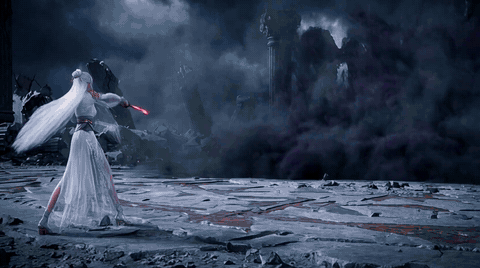

# h3-fight: a fight-scene prompt library, checker and render tool for MiniMax H3

[中文](README.md)

[Code · MIT](LICENSE) · [Prompt library and demo GIFs · CC BY-NC 4.0](库/LICENSE.md)

**In one line:** lets an AI assistant (Claude Code, Codex), or you, write MiniMax H3 fight-scene prompts using phrasing that has already produced good footage. Each prompt is checked automatically, and once it passes, one command renders it.

| Small vs. giant (C1) | One-on-one (k3b) | Aerial duel (k4d) |
|---|---|---|
|  |  |  |

All original content, rendered from the `C1`, `k3b` and `k4d` prompts in the library (1664×928, 4-second excerpts).

> Most file and folder names, the library annotations and the tool messages are in Chinese. The prompts themselves are in English. AI assistants handle the Chinese fine; if you work by hand, `库对照.md` is the readable overview of the library.

## What it is

A method for writing H3 fight prompts, in three layers:

| Layer | Contents | Requirements |
|---|---|---|
| **Core: writing prompts** | Shot-block library (378 blocks), phrase parts, move table, pitfall table, the six-section prompt format, `检查.py` (checker), `查重复.py` (repetition check). Big-motion sports such as skiing are covered in [运动.md](运动.md) | Python 3.9+ only. **No GPU needed** |
| Optional: rendering | How to build the workflow ([工作流怎么搭](docs/工作流怎么搭.md)) plus `出片.py`, which runs check → submit → wait → download → contact sheet → subtitle check | A ComfyUI that runs MiniMax H3 |
| Optional: ad post-production | Described in [广告后期.md](广告后期.md): `放大_flashvsr.py` (upscale to 2560×1440), `配乐能量.py` (find the heavy beats in a music track to cut it to the picture), `广告合成.py` (voice-over, brand end card, mix, loudness) | ffmpeg and Pillow. Upscaling also needs FlashVSR_Plus and a GPU. Read [Commercial use](#commercial-use) first |
| Not included | Reference images (character sheets) | Any image tool. Only the method is written down: [reference images](docs/参考图怎么出.md). For upscaling without FlashVSR, see [upscaling (optional)](docs/放大（可选）.md) |

Why it helps: rewriting fights from the story every time makes H3 produce run-on choreography, static cameras, blades passing through bodies and fighters swapping sides. Every block in this library has produced footage that someone reviewed by eye. Known pitfalls are encoded as checks, so a bad prompt is stopped before it is submitted.

## Three ways to use it

1. **As an AI-assistant skill (recommended).** Install it into Claude Code or Codex and say "write me a fight scene: …". The assistant picks shot blocks, reuses whole sentences and runs the checker.
2. **By hand, prompts only.** Pick blocks from `库对照.md`, assemble them as described in `SKILL.md`, then run `python3 工具/检查.py prompt.txt`. Render in your own H3 setup.
3. **With ComfyUI and H3.** Run `工具/出片.py` to render in one command, or use `--只导出` to export the workflow JSON with the prompt filled in and run it yourself in ComfyUI.

## Install

```bash
# Claude Code
git clone https://github.com/huangserva/h3-fight.git ~/.claude/skills/h3-fight
# Codex
git clone https://github.com/huangserva/h3-fight.git ~/.codex/skills/h3-fight
# Without an assistant: anywhere
git clone https://github.com/huangserva/h3-fight.git h3-fight
```

Then:

```bash
cd <install dir>
pip install -r requirements.txt        # Pillow and numpy (used by the subtitle tools)
python3 工具/自检.py                    # self-check: lists anything missing
```

You also need [ffmpeg](https://ffmpeg.org/) for the contact sheets and subtitles. After installing into Claude Code or Codex, start a new session and the skill is picked up.

> Windows: file names are Chinese. Before cloning, run `git config --global core.quotepath false` and make sure your terminal uses UTF-8.

To render, copy `config.example.json` to `config.json` and fill in your ComfyUI address:

| Field | Meaning |
|---|---|
| `mode` | `local`: ComfyUI on this machine or your LAN, over HTTP. `ssh`: ComfyUI on a remote machine; upload, submit and download go over ssh/scp |
| `comfy_url` | ComfyUI address. In `ssh` mode, this is the address **as seen on the remote machine** |
| `ssh_host` / `remote_comfy_dir` | `ssh` mode only: the ssh host name (from `~/.ssh/config`) and the remote ComfyUI root directory |
| `subtitle_font` | A CJK font file for subtitles. If empty, one is looked up automatically |

`config.json` is in `.gitignore`.

## GPU

**Writing prompts needs no GPU.** This section is about rendering only.

| Setup | Status |
|---|---|
| RTX 4090 **48GB modded** + 123GB RAM | **Tested.** One 1664×928, 243-frame segment (about 10 s) takes about 6–8 minutes from submit to download |
| 48GB+ workstation cards (RTX 6000 Ada, L40S, A100, H100, …) | Enough VRAM in principle. **Untested** |
| 24GB (regular 4090, 3090) | **Unverified.** The models alone exceed 24GB (int8 main model 21GB + int8 text encoder 27GB + video VAE 5GB). It would need model offloading, the nvfp4 text encoder (15.7GB) and so on. It will be much slower, and we have not tried it |
| Smaller GPUs / no GPU | Local rendering not recommended. Use only the prompt-writing part, or rent a cloud GPU |

The test machine has 123GB of RAM. Offloading models keeps them in system RAM, so machines with less RAM may not fit them. Keep 60GB of disk space for the models.

## Models

Select these files in the loader nodes when you build the workflow (the names may differ as long as you pick the right files).

| Role | File | Size | Folder under `ComfyUI/models/` | Download |
|---|---|---|---|---|
| Main model (fl2va/ref2va hybrid, int8) | `minimax_h3_hybrid_fl2va_ref2va_b25-49-int8.safetensors` | 21.0GB | `diffusion_models/` | [smhfacct/Minimax-H3-fl2va-ref2va-hybrid-models](https://huggingface.co/smhfacct/Minimax-H3-fl2va-ref2va-hybrid-models) |
| Text encoder | `qwen3vl_32b_minimax_h3_int8_convrot.safetensors` (if VRAM is tight, try `…_nvfp4_awq`, 15.7GB, untested) | 27.1GB | `text_encoders/` | [Comfy-Org/MiniMax-H3](https://huggingface.co/Comfy-Org/MiniMax-H3) |
| Video VAE | `minimax_h3_video_vae_fp16.safetensors` | 5.2GB | `vae/` | [Comfy-Org/MiniMax-H3](https://huggingface.co/Comfy-Org/MiniMax-H3) |
| Audio VAE | `minimax_h3_audio_vae_fp32.safetensors` | 0.6GB | `vae/` | [Comfy-Org/MiniMax-H3](https://huggingface.co/Comfy-Org/MiniMax-H3) |
| Turbo LoRA, strength 0.7 | `minimax_h3_turbo_v4_step600_ema_pruned_comfyui.safetensors` | 0.6GB | `loras/` | [drbaph/MiniMax-H3-Turbo-Lora-ComfyUI](https://huggingface.co/drbaph/MiniMax-H3-Turbo-Lora-ComfyUI) |
| Fight-interaction LoRA, strength 0.65 | `H3_Fight_Flow_V1.safetensors` | 155MB | `loras/` | [JOKER141/H3-Fight-Flow-Fight-Interaction-LoRA](https://huggingface.co/JOKER141/H3-Fight-Flow-Fight-Interaction-LoRA) |
| Combat base LoRA, strength 0.5 | `H3_Combat_V2.safetensors` | 155MB | `loras/` | [JOKER141/MiniMax-H3-Combat-Base-V2](https://huggingface.co/JOKER141/MiniMax-H3-Combat-Base-V2) |
| Motion-continuity repair LoRA, strength 0.25 | `Motion_Repair.safetensors` (V1) | 155MB | `loras/` | [JOKER141/MiniMax-H3-General-Motion-Continuity-Repair](https://huggingface.co/JOKER141/MiniMax-H3-General-Motion-Continuity-Repair) |
| Latent upscaler (used by SelfLift) | `minimax_h3_latent_upscaler_3d_conv_v1_fp16.safetensors` | 0.7GB | `latent_upscale_models/` | [LBH-123-AI/Minimax_h3_latent_Upscaler](https://huggingface.co/LBH-123-AI/Minimax_h3_latent_Upscaler) (inside `minimax_h3_latent_upscaler_3d_conv_v1/`) |

The three fight LoRAs are not redistributed here. Download them from the author's page and follow the author's license. Each model has its own license; check it before use.

## ComfyUI and custom nodes

- **ComfyUI**: a version with native MiniMax H3 support (tested: 0.34.0). `MiniMaxH3ReferenceToVideo`, `MiniMaxH3AddGuide`, `ResolutionSelector` and `LoraLoaderBypassModelOnly` are built in.
- **Custom nodes**, installed into `ComfyUI/custom_nodes/`:

| Node pack | Nodes used |
|---|---|
| [slmonker/selflift-Avatar](https://github.com/slmonker/selflift-Avatar) | `SelfLiftAvatarH3TST`, `SelfLiftAvatarH3Sampler` (motion at low resolution, then latent upscale and refine) |
| [yichengup/ComfyUI-YCNodes-MiniMax-H3](https://github.com/yichengup/ComfyUI-YCNodes-MiniMax-H3) | `H3SigmaRefiner` (extra steps in the low-noise range, removes grain at motion edges) |
| [T8mars/comfyui-minimax-h3-audio-T8](https://github.com/T8mars/comfyui-minimax-h3-audio-T8) | `MiniMaxH3AVDecodeT8`, `MiniMaxH3AudioConditioningT8` (audio-video decode; conditioning when there are no reference images) |

### Build the workflow

The repository **does not ship workflow files**, only instructions. Build the workflow in ComfyUI following [docs/工作流怎么搭.md](docs/工作流怎么搭.md) (about 20 nodes; the node and parameter names in that document are the ComfyUI names). Then use Export (API) to save it as `库/模板/三参考图.json` (with reference images) and `库/模板/无参考图.json` (prompt only). Node IDs don't matter: `出片.py` finds nodes by role and fills in the number of reference images, the first-frame guide, the seed and the output name.

Then run `python3 工具/自检.py`. It checks every node and model file against ComfyUI's `/object_info`.

## Quick start

```bash
# 0. Build the workflow first (see above)
# 1. Write: assemble my_fight.txt from library blocks (or ask your AI assistant)
# 2. Check: fix every "错误" (error)
python3 工具/检查.py my_fight.txt
# 3. Render with three reference images: character, scene, opponent
python3 工具/出片.py my_fight.txt --名字 fight01 --输出 out/ --参考图 hero.png arena.png rival.png
# 4. Continue the fight in the next segment: pin its first frame to the last frame of the previous one
ffmpeg -sseof -0.05 -i out/fight01.mp4 -frames:v 1 out/fight01_last.png
python3 工具/出片.py my_fight2.txt --名字 fight02 --输出 out/ --参考图 hero.png arena.png rival.png --首帧 out/fight01_last.png
```

Option names: `--名字` = name, `--输出` = output dir, `--参考图` = reference images, `--加参考图` = extra reference images (up to 9 in total), `--首帧` = first-frame guide, `--种子` = seed, `--非打斗 "reason"` = non-fight segment (the check prints but does not block), `--只导出` = export the workflow JSON only, `--最多等 120` = how many minutes to wait for the render before giving up (0 = wait forever). The name may contain only letters, digits, CJK characters, `_`, `-` and `.`.

`k4f` in the library is the entry example for the 5-shot layout. Copying `库/来源/k4f.txt` and swapping the characters and weapons is the fastest way in. It was re-cut from `k4d`, the clip in the demo GIF above, which uses the older 6-shot layout timed for a 15-second clip. Reading the two side by side shows how many moves fit in each shot of a 10-second clip. `k3f` is the segment that comes before `k4f`, also in the 5-shot layout; the two cut together into 20 seconds. Use that pair as the example for a two-segment fight: how the moves are split between segments, and how the first segment ends on the framing the second one opens with.

## Fixed parts and parameters

Most of the good footage in the library was rendered with these parts, and the prompt-writing rules were validated on them.

| Part | Value |
|---|---|
| Main model | hybrid fl2va/ref2va b25-49 int8 (works with both reference images and first-frame guides) |
| Turbo LoRA | 0.7 |
| SelfLift TST | τ 0.2 (motion at low resolution, then latent upscale and refine) |
| Fight LoRAs | Fight_Flow 0.65 / Combat_V2 0.5 / Motion_Repair 0.25 (without fight LoRAs, H3's martial arts are poor) |
| Sampling | euler, 8 steps + SigmaRefiner |
| Size | 1664×928, 243 frames, 24 fps (about 10 s per segment) |
| Seed | 1, one render per shot |

When you change how you write prompts, don't change parts at the same time, or you can't tell which change mattered.

## Limits

- At most about 10 s (243 frames) per segment. Longer films are several segments joined together.
- At most one short spoken line per segment.
- Shots dominated by lightning, magic or energy effects don't suit this method (the effects run wild).
- What the prompt describes and what H3 draws often differ, so always review the footage. Add new problems you find to the pitfall table.
- 24GB GPUs are unverified.

## Repository layout

```
SKILL.md            How to write the prompts (for AI assistants; people can follow it too)
运动.md              How to write big-motion sports such as skiing
广告后期.md          Turning a finished clip into an ad: upscale, music, voice-over, brand end card, loudness
库对照.md            Human-readable overview of the library (generated)
库/                  Source prompts, shot blocks, phrases, move table, pitfall table; 模板/ holds the workflows you build
工具/                Prompts: 检查 (check) 查重复 (repetition) 建库 (build library) 生成对照页 (overview page)
                     Rendering: 出片 (render) 连接 (ComfyUI connection) 自检 (self-check)
                     Subtitles: 加字幕 (add) 查字幕 (find burned-in) 去字幕 (remove)
                     Ad post-production: 放大_flashvsr (upscale) 配乐能量 (music beats) 广告合成 (ad assembly)
测试/                Regression tests (no GPU and no ComfyUI needed)
docs/                Building the workflow, reference images, upscaling (optional), demo GIFs
config.example.json  Render connection settings (example)
```

After changing the library or the tools, run the tests:

```bash
python3 -m unittest discover -s 测试
```

They check three things. Every A-grade source passes the checker and every B-grade source fails it. `镜头块.json` and `库对照.md` match the sources (after editing a source, rerun `工具/建库.py`). `出片.py` stops and explains why when ComfyUI is unreachable, rejects the workflow, or loses the job.

## License and credits

- The code in `工具/` is licensed under [MIT](LICENSE).
- This project's prompt library (`库/`, `库对照.md`) and demo GIFs (`docs/效果/`) are licensed under [CC BY-NC 4.0](库/LICENSE.md). See the license notice for attribution, marking changes, and third-party credits. For commercial use, see [Commercial use](#commercial-use) below.
- **Credits**
  - The BUNNY author ([JOKER141](https://huggingface.co/JOKER141) on Hugging Face, FourBunny on Civitai): the three fight LoRAs. The 16 signature phrasings were learned from the author's demo prompts; only the short phrases are in the library, not the original prompts. Our workflow is based on the author's public SelfLift workflow (the repository ships only instructions for building it, not the workflow file).
  - [MiniMax H3](https://huggingface.co/MiniMaxAI/MiniMax-H3) and the [Comfy-Org](https://huggingface.co/Comfy-Org/MiniMax-H3) ComfyUI release.
  - The turbo LoRA packaged by [drbaph](https://huggingface.co/drbaph/MiniMax-H3-Turbo-Lora-ComfyUI).
  - The hybrid main model by [smhfacct](https://huggingface.co/smhfacct/Minimax-H3-fl2va-ref2va-hybrid-models).
  - The latent upscaler by [LBH-123-AI](https://huggingface.co/LBH-123-AI/Minimax_h3_latent_Upscaler).
  - The authors of the three node packs above.
- **Please don't** use this to generate characters that infringe someone else's copyright, or to impersonate real people. The anime examples in the library have had all character names, technique names and identifying appearance details removed.

### Commercial use

If you want to use your renders commercially (including ads made by following [广告后期.md](广告后期.md)), check each of these licenses separately:

1. **The prompts in this library**: CC BY-NC 4.0, which permits noncommercial use only. The code in `工具/` is MIT and is not affected.
2. **The MiniMax H3 model**: according to the [ComfyUI documentation](https://docs.comfy.org/tutorials/video/minimax/minimax-h3), commercial use of locally generated output requires a MiniMax commercial license, available through Comfy; output generated on Comfy Cloud already includes commercial rights. Check the official terms for the current wording.
3. **The other models, LoRAs and node packs**: each has its own license (see the model list above). Read each one before use.
